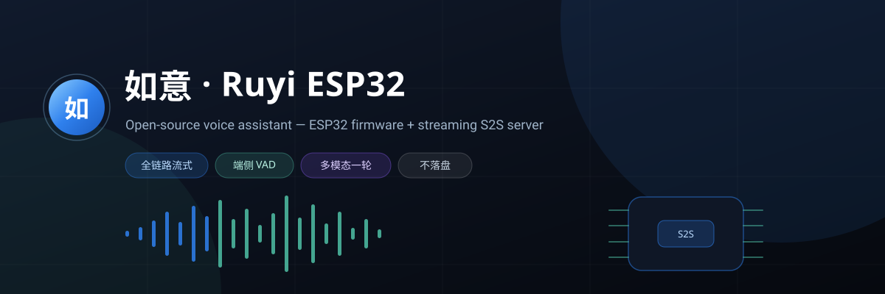
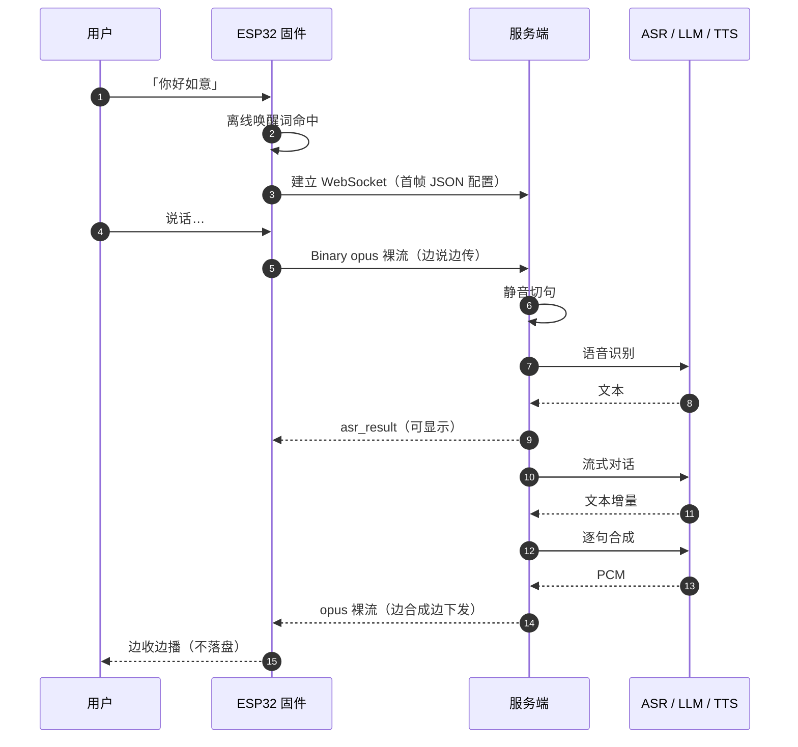

<div align="center">



**一块 ESP32-S3 + 一条 WebSocket = 完整可用的中文语音助手**

离线唤醒 · 端侧 VAD/AEC · 全链路流式 S2S · 浏览器即可试听

[](LICENSE)
[](https://docs.espressif.com/projects/esp-idf/)
[](server/)
[](server/README.md#协议速查)
[](server/README.md#支持的服务商)

[快速开始](#30-秒上手) · [架构](#它是怎么跑起来的) · [服务端](server/README.md) · [协议](server/README.md#协议速查) · [常见问题](#常见问题)

</div>

---

## 目录

| 章节 | 你会得到什么 |
| :--- | :--- |
| [这是什么](#这是什么) | 三分钟了解项目边界 |
| [核心特性](#核心特性) | 为什么不是又一个「语音 Demo」 |
| [它是怎么跑起来的](#它是怎么跑起来的) | 一张图看懂端到端链路 |
| [30 秒上手](#30-秒上手) | 不接硬件也能先听见如意说话 |
| [服务端两种模式](#服务端两种模式) | 一把云端 Key，或者全部自建 |
| [固件编译](#固件编译) | ESP-IDF 从零到烧录 |
| [目录结构](#目录结构) | 代码在哪、改哪里 |
| [常见问题](#常见问题) | 踩坑速查 |

---

## 这是什么

一套**完整可部署**的中文语音交互方案，由两部分组成：

- **固件**：基于 ESP32-S3 的语音终端。离线唤醒、端侧 VAD、AEC 回声消除、Opus 编解码，接上麦克风和喇叭就能说话。
- **服务端**：一条 WebSocket 承载「语音识别 → 大模型对话 → 语音合成」全链路，Python 编写、单文件配置、自带管理后台与浏览器对话页。

固件源自开源项目 [xiaozhi-esp32](https://github.com/78/xiaozhi-esp32)，我们重写了协议与服务端：
把官方那套 Java / MQTT / UDP / WebSocket 多协议栈，收敛成**一条 WebSocket + 一套 JSON 事件**，
端到端不落盘、全程流式，任何语言半天就能对接。

> 它不是玩具：这是一套在生产环境跑着的链路，语音响应（说完到听见第一声）通常 1 秒出头。

---

## 核心特性

| | 能力 | 说明 |
| :--- | :--- | :--- |
| ⚡ | **全链路流式** | ASR → LLM 分句 → TTS 边合成边下发 → 设备边收边播，不做「等全部生成完再说」 |
| 🎙 | **端侧 VAD + 服务端切句** | 设备持续上行，服务端按静音切句，短句、数字串识别更稳 |
| 🧠 | **双向可换引擎** | 默认如意云一把 Key 即用；也可本地串接字节 / 阿里 / DeepSeek / 智谱 |
| 🖼 | **多模态一轮对话** | 音频与摄像头画面放进同一帧，AI 既听到你说话，也看到你眼前的画面 |
| 🎛 | **管理后台** | `/admin` 点选切换模式与厂商，改完自动保存，下一条连接即生效 |
| 🌐 | **浏览器对话页** | `/demo` 点话筒就能连续对话，不接硬件也能验证整条链路 |
| 💸 | **零落盘** | 音频全程内存调度，不留文件、不排队 |
| 📦 | **协议即文档** | 十余种 JSON 事件 + 二进制音频帧，附带固件实现可对照 |

服务商支持一览：

| 能力 | 支持 |
| :--- | :--- |
| ASR | 字节豆包 · 阿里 Paraformer · 如意云 |
| LLM | 字节豆包 · 阿里通义 · DeepSeek · 智谱 GLM · 如意云 |
| TTS | 字节豆包 · 阿里 CosyVoice · 如意云 |
| 模式 | **如意云透传**（填 Key 即用） / **自编排**（密钥全在自己手里） |

---

## 它是怎么跑起来的



**关键约束**

- 上行：16 kHz 单声道 Opus，20 ms 一帧，`[2 字节小端长度][帧]` 裸流
- 下行：48 kHz / 64 kbps Opus，同样的裸流结构，设备按 `tts_start.sample_rate` 配解码器
- 一句话一轮：`asr_result → llm_start → llm_chunk → tts_start → tts_sentence → Binary → tts_sentence_end → tts_done → done`

> 完整字段与事件说明见 [server/README.md · 协议速查](server/README.md#协议速查)。

---

## 30 秒上手

**不接硬件，先听见如意说话**（需要 Python 3.10+）：

```bash
# 1. 系统依赖（opus 编解码）
sudo apt install -y libopus0

# 2. 装依赖、起服务
cd server
pip install -r requirements.txt
cp config.example.yaml config.yaml
# 编辑 config.yaml：填入 nice.api_key（免费申请见下）
python run.py
```

打开两个地址：

| 地址 | 用途 |
| :--- | :--- |
| `http://localhost:8892/demo` | 浏览器对话页：点话筒连续对话；开摄像头后每句话都带一帧画面给 AI |
| `http://localhost:8892/admin` | 管理后台：切换模式、填各家密钥、测试连通性 |

**申请如意云 S2S Key（免费）**：手机号登录 <https://dev.nice-ai.cn/open/> → 完善资料 → 申请 Key。

> 仓库不携带任何密钥：`sdkconfig.defaults` 里的 `CONFIG_S2S_API_KEY` 为空，请自行填写。

---

## 服务端两种模式

| | 如意云透传（默认） | 自编排 |
| :--- | :--- | :--- |
| **怎么做** | 本服务只做协议转发，编排全在如意云 | 本机串接 ASR→LLM→TTS 三段流水线 |
| **要填什么** | 一把 `nice.api_key` | 各家厂商的 Key / AppID |
| **适合谁** | 想最快跑通、不想逐家开通服务 | 已有厂商账号、要完全掌控数据与音色 |
| **代码量** | 一个代理类 | 每个能力一个 provider，接口统一 |

两种模式共用同一个 `/s2s/ws` 端点、同一套下行消息，**固件零改动**。
切换只在 `/admin` 点一下，下一条连接立即生效。

```
server/s2s/providers/
├── nice.py          如意云透明代理
├── llm_openai.py    OpenAI 兼容流式（四家通用）
├── asr_doubao.py    字节火山流式识别
├── asr_aliyun.py    阿里 Paraformer 实时识别
├── tts_doubao.py    字节豆包流式合成
└── tts_aliyun.py    阿里 CosyVoice 流式合成
```

加一家新厂商 = 实现 `base.py` 的一个基类 + 注册一行 + 后台加个标签，**会话编排层不感知厂商差异**。

---

## 固件编译

```bash
# ESP-IDF 5.3+（推荐 5.3 / 5.4）
idf.py set-target esp32s3
cp sdkconfig.defaults sdkconfig      # 首次：默认 Key 为空
idf.py menuconfig                     # NiceAI Configuration
#   ├─ S2S API Key      填你的密钥
#   └─ OTA / S2S URL    wss://你的服务器:8892/s2s/ws
idf.py build flash monitor
```

- 默认板型配置：`sdkconfig.sisi` / `sdkconfig.meeting`，可对照修改引脚与音频通路
- 固件连接时自动附带 `?api_key=xxx&firmware_version=xxx`
- 服务端 `server.api_keys` 非空时校验首帧 Key，留空则不校验（适合内网）

---

## 目录结构

```
ruyi-esp32/
├── main/                    固件主逻辑（唤醒、状态机、音频、协议）
│   ├── app.cc               会话状态机与音频流转
│   ├── protocol.cc          S2S 协议编解码
│   └── websocket.cc         WebSocket 连接与重连
├── components/              板级驱动、音频编解码、显示等
├── sdkconfig.defaults       公开默认配置（不含密钥）
├── server/                  配套开源服务端  → server/README.md
│   ├── run.py               启动入口
│   ├── config.example.yaml  配置样例
│   └── s2s/
│       ├── app.py           FastAPI：WS 端点 + 后台 + Demo
│       ├── session.py       S2S 状态机与流水线编排
│       ├── audio.py         Opus 编解码与重采样
│       ├── static/          管理后台 / 浏览器对话页
│       └── providers/       各厂商实现
├── docs/banner.svg          仓库头图
└── LICENSE
```

---

## 常见问题

<details>
<summary><b>没有硬件，能先听效果吗？</b></summary>

能。起服务端后打开 `/demo`，浏览器录音 → 服务端 → 大模型 → 语音回放，走的是同一套协议。
仅需 Chrome / Edge / Safari 16.4+（下行用 WebCodecs 解码 opus）。
</details>

<details>
<summary><b>一定要如意云的 Key 吗？</b></summary>

不需要。切到「自编排」，自己填字节 / 阿里 / DeepSeek / 智谱的 Key 即可，数据不经过如意云。
</details>

<details>
<summary><b>能换成自己的音色吗？</b></summary>

可以。TTS provider 里 `voice` 字段即音色 ID；如意云模式支持克隆音色与情绪音色。
</details>

<details>
<summary><b>为什么听不到第一句话的开头？</b></summary>

检查 `tts_start.sample_rate`（下行固定 48 kHz）与设备解码器采样率是否一致，
以及客户端是否在收到 `tts_start` 之前就初始化了解码器。
</details>

<details>
<summary><b>唤醒词怎么换？</b></summary>

固件侧更换唤醒模型与词表即可，服务端不参与唤醒判定——唤醒在端侧完成，命中后才建立会话。
</details>

---

## 相关链接

- 服务端文档与协议详解：[server/README.md](server/README.md)
- 如意云 S2S Key 申请：<https://dev.nice-ai.cn/open/>
- 上游固件项目：[xiaozhi-esp32](https://github.com/78/xiaozhi-esp32)

## License

[MIT](LICENSE)
