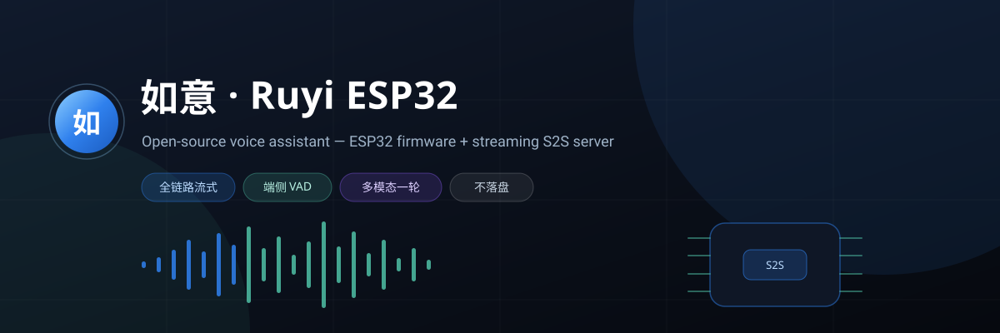
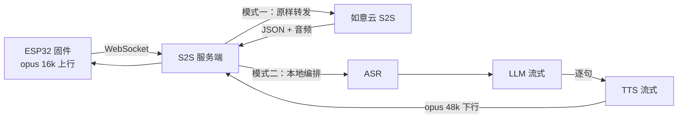

<div align="center">



**一条 WebSocket，跑完语音识别 → 大模型对话 → 语音合成**

Python 3.10+ · FastAPI · 全链路流式 · 不落盘

[](https://www.python.org/)
[](https://fastapi.tiangolo.com/)
[](#协议速查)
[](#两种工作模式)

[快速开始](#快速开始) · [两种模式](#两种工作模式) · [浏览器 Demo](#浏览器-demo) · [协议](#协议速查) · [部署](#部署到公网)

> **在线体验**：<https://dev.nice-ai.cn/ruyi/demo>（官方托管的 Demo 页，无需安装）

</div>

---

## 它是做什么的

固件只说两种语言：**JSON 事件** 和 **二进制音频帧**。这个服务端负责把这两样东西
翻译成「识别 → 对话 → 合成」，再把结果流回去：



- **不落盘**：音频块在内存里进、内存里出
- **不攒批**：TTS 合成一块就编码一块、下发一块，设备边收边播
- **不绑定**：换 ASR / LLM / TTS 只改配置，编排代码零改动

---

## 两种工作模式

| | 如意云透传（默认） | 自编排 |
| :--- | :--- | :--- |
| **一句话** | 只做协议转发 | 本机串起三段流水线 |
| **需要配置** | `nice.api_key` | 各厂商 Key / AppID |
| **编排在哪** | 如意云 | 本服务 |
| **延迟** | 多一跳本机转发 | 取决于所连厂商 |
| **适合** | 快速跑通、免逐家开通 | 数据自持、音色与模型自选 |

切换与填 Key 都在 **`/admin`**：点选标签、改完自动保存，**下一条连接**即生效（不重启服务）。

```yaml
asr: {provider: nice | doubao | aliyun}
llm: {provider: nice | doubao | aliyun | deepseek | zhipu}
tts: {provider: nice | doubao | aliyun}
```

> 三个能力全为 `nice` → 透传模式；任一不是 `nice` → 走本机自编排。

---

## 支持的服务商

| 能力 | 服务商 | 说明 |
| :--- | :--- | :--- |
| **ASR** | 字节豆包 SAUC | 流式识别，`bigmodel` |
| | 阿里 Paraformer | `paraformer-realtime-v2` |
| **LLM** | 字节豆包 | 火山方舟，OpenAI 兼容 |
| | 阿里通义 | DashScope compatible-mode |
| | DeepSeek | `deepseek-chat` |
| | 智谱 GLM | `glm-4-flash` |
| **TTS** | 字节豆包 | 单向流式合成 |
| | 阿里 CosyVoice | `cosyvoice-v2` |
| | 自建零样本 TTS | 吃 `/studio` 录的参考音（HTTP 流式 PCM） |
| **全部** | 如意云 | 一把 Key，含克隆音色与情绪音色 |

---

## 快速开始

```bash
# 1. 系统依赖：libopus
sudo apt install -y libopus0

# 2. Python 依赖（建议独立虚拟环境）
python -m venv .venv && source .venv/bin/activate
pip install -r requirements.txt

# 3. 配置
cp config.example.yaml config.yaml
#   最小可用：只需填 nice.api_key
#   免费申请：https://dev.nice-ai.cn/open/ （手机号登录 → 完善资料 → 申请 Key）

# 4. 启动
python run.py          # 默认 0.0.0.0:8892
```

| 地址 | 说明 |
| :--- | :--- |
| `http://<host>:8892/demo` | 浏览器对话页（不接固件即可试通链路） |
| `http://<host>:8892/admin` | 管理后台（模式 / 密钥 / 连通性测试） |
| `ws://<host>:8892/s2s/ws` | 固件接入端点 |

---

## 浏览器 Demo

打开 `/demo`，点一下话筒就开始：

- **自动连续对话**：本地能量 VAD 切句，静音 600 ms 自动提交一句，再点一次结束
- **底部三键**：左「发照片」、中「话筒」、右「摄像头」
- **摄像头上屏**：画面铺满做聊天背景，气泡半透明毛玻璃
- **每句带画面**：摄像头开启时，每说一句自动抓一帧（448 px / JPEG q0.6），与该句音频同帧送 AI
- **语音回放**：下行 opus 用 WebCodecs 解码，Chrome / Edge / Safari 16.4+

> Demo 与固件走**同一套协议**，只把上行从「opus 裸流」换成「整段 PCM base64」，
> 因此两种模式都能直接用，适合联调与演示。

---

## 音色工坊

服务端内置 `/studio`：录一段 3~10 秒的话（或上传音频）→ 自动降噪 / 裁静音 / 归一化 →
存成音色 → 绑到 AI 角色。设备说话就是你的声音。

- 浏览器录音直接采 16 kHz PCM，**不依赖 ffmpeg**；上传 mp3/m4a 才需要系统装 ffmpeg
- 数据全在 `server/data/`：`sisi.db`（SQLite）+ `voices/*.wav`，备份拷这一个目录即可
- 「合成」按钮要求 TTS 支持参考音 → 在 `/admin` 把 TTS 切到「自建 · 零样本 TTS」

### 接入自建零样本 TTS

`tts.provider = local` 时，服务端向 `tts.local.url` 发送：

```
POST <url>
{
  "text": "要合成的文字",
  "format": "pcm",
  "sample_rate": 24000,
  "ref_audio": "<base64 wav>",   // 音色工坊的参考音，可省略
  "ref_text": "参考音对应的文字"   // 可省略
}
→ 200，响应体为 PCM int16 单声道裸流（支持 chunked 流式返回）
```

CosyVoice2 / IndexTTS / VoxCPM / GPT-SoVITS 等自建推理服务，外面套这一层协议即可，
本项目不需要改任何代码。

### AI 角色

`POST /api/ais`（名字 + 人设提示词 + 音色）。设备首帧带 `ai_id` 即生效；
只想换声音不换人设时，用 `voice: "studio:3"`。

## 固件接入

固件侧只需一个地址（同一地址同时是 OTA 与 S2S 入口）：

```
idf.py menuconfig → NiceAI Configuration
  ├─ S2S API Key     ← 你的密钥（与 server.api_keys 白名单对应，留空则不校验）
  └─ OTA / S2S URL   ← wss://你的服务器:8892/s2s/ws
```

固件连接时自动附带 `?api_key=<编译值>&firmware_version=<版本>`。

---

## 协议速查

### 上行（固件 → 服务端）

| 帧 | 内容 | 说明 |
| :--- | :--- | :--- |
| 首帧 JSON | `api_key` `format` `sample_rate` `language` `voice` `output_format` `stream_text` `stream_upload` | 认证 + 本连接默认参数 |
| `hello` | `board` `has_aec` | 设备能力上报 |
| **Binary** | `[2B 小端长度][opus 帧 20ms@16k]` × N | 边说边传 |
| `listen_stop` | — | 兼容旧客户端，触发本轮 |
| `abort` | — | 打断当前生成 |
| `tts_playback_done` | — | 设备真正播完 |

**浏览器 / 手机端（Demo 用法）**

| 帧 | 内容 | 说明 |
| :--- | :--- | :--- |
| JSON | `{audio: "<base64 PCM16 16k>", image: "<base64 JPEG>"}` | 一轮一帧，`image` 可选（多模态） |
| JSON | `{noaudio: true, text, image}` | 纯图片 / 纯文本轮 |

> ⚠️ **连接的第一轮必须把音频放进首帧**（或紧接着发 Binary）。
> 之后的轮次才可以发普通 JSON 帧——这是如意云与自编排模式共同的行为。

### 下行（服务端 → 固件）

| 消息 | 关键字段 | 说明 |
| :--- | :--- | :--- |
| `asr_result` | `text` `lang` `speaker_name` | 识别结果，可先上屏 |
| `llm_start` | `round` | 开始生成 |
| `llm_chunk` | `text` | 文本增量（`stream_text=true`） |
| `tts_start` | `sample_rate` `format` `channels` | 下行音频参数（48 kHz / opus） |
| `tts_sentence` | `index` `text` | 每句合成前的文本 |
| **Binary** | — | opus 裸流，边合成边下发 |
| `tts_sentence_end` | `index` | 本句音频结束 |
| `tts_done` | `round` | 本轮音频发送完毕 |
| `done` | `asr_text` `llm_text` `total_ms` | 本轮结束 |
| `aborted` | `asr_text` `llm_text` | 被客户端打断 |
| `error` | `message` | 任意阶段出错 |

一轮的典型顺序：

```
asr_result → llm_start → llm_chunk* → tts_start
           → (tts_sentence → Binary* → tts_sentence_end)*
           → tts_done → done
```

---

## 新增一家厂商

1. 在 `s2s/providers/` 实现 `BaseASR` / `BaseLLM` / `BaseTTS` 之一：

```python
class MyLLM(BaseLLM):
    async def stream_chat(self, system_prompt, messages):
        # 逐段 yield 文本增量即可，编排层负责分句与 TTS
        ...
```

2. `providers/__init__.py` 注册 `build_*` 分支
3. `config.py` 的 `DEFAULT_CONFIG` 补一节默认值
4. `static/admin.html` 加一个厂商标签

会话编排（`session.py`）不感知厂商差异。

---

## 目录结构

```
server/
├── run.py                  启动脚本（读 config.yaml 的 host/port）
├── config.example.yaml     配置样例（复制为 config.yaml）
├── requirements.txt
└── s2s/
    ├── app.py              FastAPI：WS 端点 / 管理后台 API / Demo 页
    ├── config.py           YAML 加载、原子保存、就绪校验
    ├── session.py          S2S 状态机 + ASR→LLM→TTS 流水线
    ├── audio.py            opus 裸流编解码 + 重采样（48k 下行）
    ├── voice_audio.py      参考音处理：解码 / 降噪 / 裁静音 / 归一化
    ├── store.py            SQLite 单文件存储（音色 / AI 角色）
    ├── static/
    │   ├── admin.html      管理后台（标签点选 / 自动保存 / 居中 toast）
    │   ├── demo.html       浏览器对话页（录音 + 摄像头 + 气泡界面）
    │   └── studio.html     音色工坊（录音 / 上传 / 建 AI）
    └── providers/
        ├── base.py         ASR / LLM / TTS 三个基类
        ├── nice.py         如意云透明代理
        ├── llm_openai.py   OpenAI 兼容流式（四家通用）
        ├── asr_doubao.py   字节火山流式识别
        ├── asr_aliyun.py   阿里 Paraformer
        ├── tts_doubao.py   字节豆包流式合成
        ├── tts_aliyun.py   阿里 CosyVoice
        └── tts_local.py    自建零样本 TTS（吃音色工坊的参考音）
```

---

## 部署到公网

**systemd**

```ini
[Unit]
Description=sisi-esp-server
After=network.target

[Service]
WorkingDirectory=/opt/sisi-esp/server
ExecStart=/opt/sisi-esp/server/.venv/bin/python run.py
Restart=always

[Install]
WantedBy=multi-user.target
```

**Nginx（把 WebSocket 反代出去，注意关闭缓冲）**

```nginx
location /s2s/ {
    proxy_pass http://127.0.0.1:8892/s2s/;
    proxy_http_version 1.1;
    proxy_set_header Upgrade $http_upgrade;
    proxy_set_header Connection "upgrade";
    proxy_buffering off;          # ★ 音频必须即时转发
    proxy_read_timeout 300s;
}
```

固件地址填 `wss://你的域名/s2s/ws`。

---

## 常见问题

<details>
<summary><b>启动报 <code>libopus.so</code> 找不到</b></summary>

`sudo apt install -y libopus0`（Debian/Ubuntu）或 `brew install opus`（macOS）。
</details>

<details>
<summary><b>连上了但一直没回复，日志显示「首帧等待超时」</b></summary>

第一轮没收到音频。核对固件 `stream_upload` 是否为 `true`，或 Demo 是否把 `audio` 放进了首帧。
</details>

<details>
<summary><b>声音断续 / 首字被吞</b></summary>

- 下行为 48 kHz opus，确认设备解码器采样率与 `tts_start.sample_rate` 一致
- 客户端必须在收到 `tts_start` 时就初始化解码器，不能等数据到了才建
</details>

<details>
<summary><b>能同时服务多台设备吗？</b></summary>

可以。每条 WebSocket 连接一个独立会话，ASR/LLM/TTS 实例按连接创建；配置只有一份 `config.yaml`，改动对下一条连接生效。
</details>

<details>
<summary><b>如何保护管理后台？</b></summary>

`config.yaml` 里设置 `server.admin_password`，页面会要求输入口令（`X-Admin-Token` 校验）。
公网部署建议再用 Nginx Basic Auth 兜一层。
</details>

---

## License

[MIT](../LICENSE)
